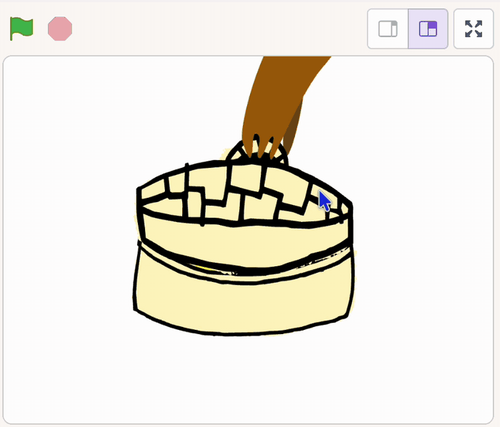

## Lift the lid

Open the basket with a click.

The starter project is open beside these instructions, with all the sprites you need.

## Step 1

Click on the **lid sprite**, it has some blocks to get you started.

{:width="80px"}

## Step 2

Make the lid glide up when it is clicked.

```blocks3
+when this sprite clicked
+glide (1) secs to x: (65) y: (120)
```

## Step 3

Let the lid wait, then glide back down.

```blocks3
when this sprite clicked
glide (1) secs to x: (65) y: (120)
+wait (1) seconds
+glide (1) secs to x: (0) y: (0)
```

## Step 4

Send the `lid`{:class="block3events"} message as the lid lifts, ready for the dumpling to answer.

```blocks3
when this sprite clicked
+broadcast (lid v)
glide (1) secs to x: (65) y: (120)
wait (1) seconds
glide (1) secs to x: (0) y: (0)
```

## Now run your code

Click on the **lid**. Check that it lifts up and settles back down.

{:width="450px"}
