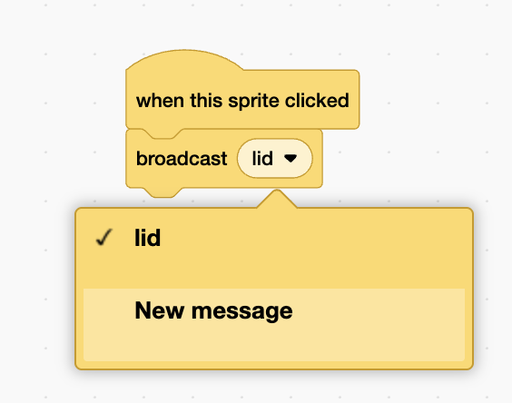

## Lift the lid

Open the basket by making the lid glide when it is clicked.

The starter project is open beside these instructions, with the dumpling and lid sprites ready to use.

## Step 1

Click on the **lid sprite**.

{:width="80px"}

## Step 2

Make the lid go to the middle of the stage, in front of the dumpling, when the green flag is clicked.

```blocks3
+when green flag clicked
+go to x: (0) y: (0)
+go to [front v] layer
```

## Step 3

Make the lid glide up when it is clicked.

```blocks3
+when this sprite clicked
+glide (1) secs to x: (65) y: (120)
```

## Step 4

Let the lid wait, then glide back down.

```blocks3
when this sprite clicked
glide (1) secs to x: (65) y: (120)
+wait (1) seconds
+glide (1) secs to x: (0) y: (0)
```

## Step 5

Create a new message called `lid`{:class="block3events"}, then broadcast it as the lid lifts.

```blocks3
when this sprite clicked
+broadcast (lid v)
glide (1) secs to x: (65) y: (120)
wait (1) seconds
glide (1) secs to x: (0) y: (0)
```

> [!TIP]
>
> Click on the drop-down arrow and name the new message 'lid'.
>
> {:width="450px"}

## Now run your code

Click on the **lid**. Check that it glides up, then glides back down.

{:width="450px"}
