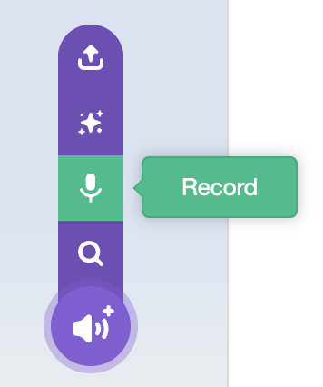
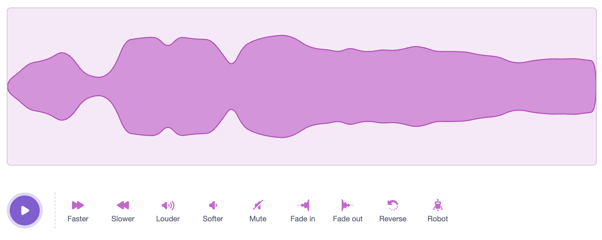

## Record a rainbow sound

Make and edit a rainbow sound.

{:width="80px"}

You're still working on the **dumpling sprite**.

## Step 1

Open the **Sounds** tab.

{:width="450px"}

## Step 2

Record a new sound for the rainbow.

{:width="250px"}

## Step 3

Edit the sound with the buttons underneath it.

{:width="450px"}

## Step 4

Rename your sound 'oh a rainbow'.

**Test:** Click **Play**. Check that you can hear your new sound.
