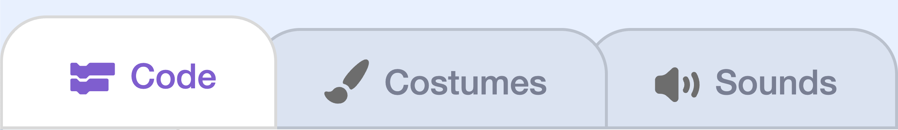

## Add rainbow sound

Add the new sound to your code.

{:width="80px"}

You're still working on the **dumpling sprite**.

## Step 1

Open the **Code** tab.

{:width="450px"}

## Step 2

Play a sound before the colours start to change.

```blocks3
when I receive [rainbow v]
+start sound (oh a rainbow v)
repeat (15)
change [color v] effect by (25)
wait (0.1) seconds
end
clear graphic effects
```

## Now run your code

Click on the **rainbow**. Check that your sound plays while the colours change.
