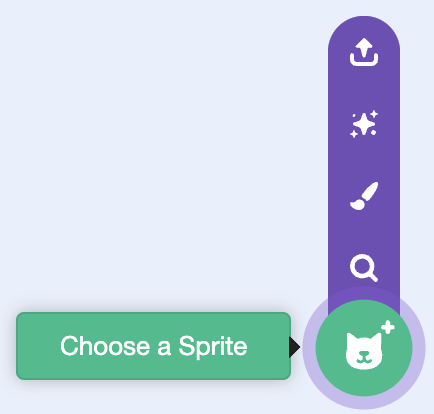
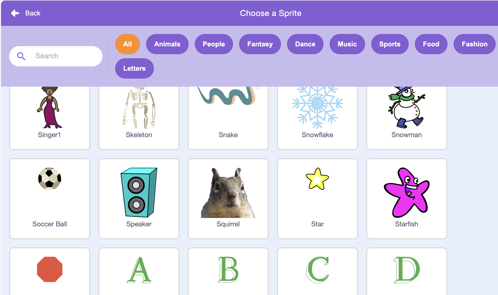
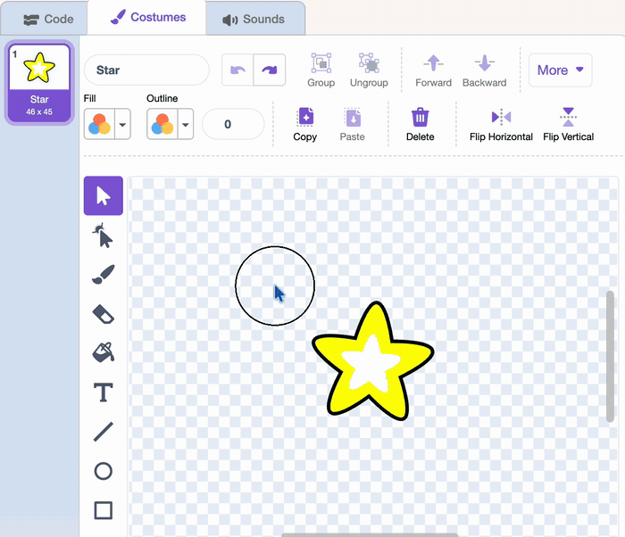

## Add a star button

Add a second button for the stars.

{:width="80px"}

## Step 1

Click **Choose a Sprite**.

{:width="250px"}

## Step 2

Choose the **star sprite** from the sprite library.

{:width="450px"}

## Step 3

Resize the star using the paint tools.

{:width="450px"}
