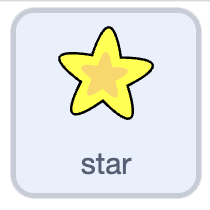
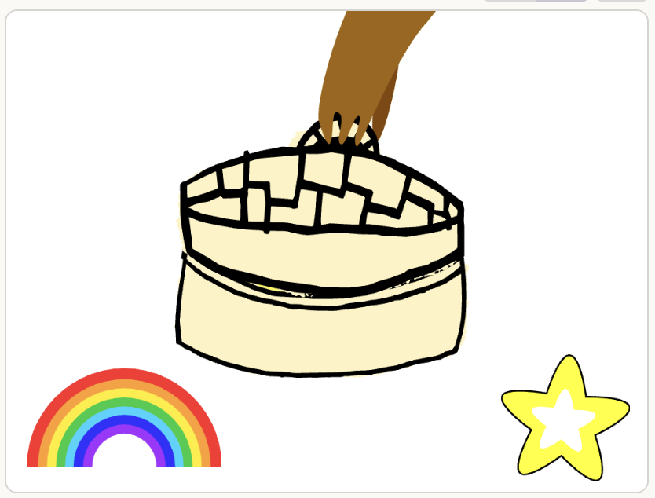

## Position the star

Move the star, then make it send a message when it is clicked.

{:width="80px"}

You're still working on the **star sprite**.

## Step 1

On the stage, drag the star to the right.

## Step 2

Position the star using the `go to x: y:`{:class="block3motion"} block.

```blocks3
+when green flag clicked
+go to x: (153) y: (-123)
+set size to (100) %
```

## Step 3

Send a new message and name it `stars`{:class="block3events"} when the star is clicked.

```blocks3
+when this sprite clicked
+broadcast (stars v)
```

## Now run your code

Click the **Green Flag**. Check that the **star** goes to the bottom right of the stage.

{:width="450px"}
