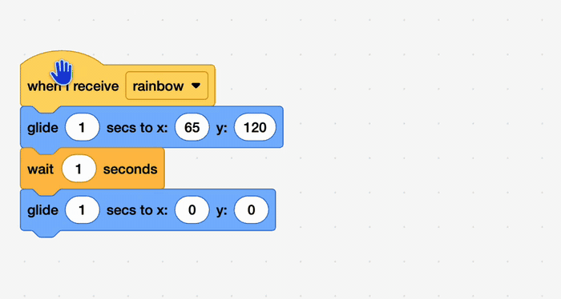
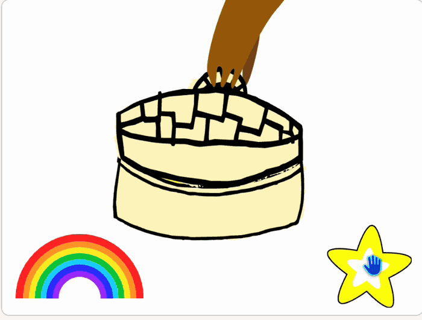

## Lift the lid for the star

Make the lid move when the star is clicked.

## Step 1

Click on the **lid sprite**.

{:width="80px"}

## Step 2

Make the lid glide up when it receives the `star`{:class="block3events"} message. It waits, then glides back down.

```blocks3
+when I receive [star v]
+glide (1) secs to x: (65) y: (120)
+wait (1) seconds
+glide (1) secs to x: (0) y: (0)
```

> [!TIP]
>
> Right-click to duplicate the `when I receive rainbow`{:class="block3events"} script, then choose 'star' from the drop-down menu.
>
> {:width="450px"}

## Now run your code

Click on the **star**. Check that the lid glides up, then glides back down.

{:width="450px"}
