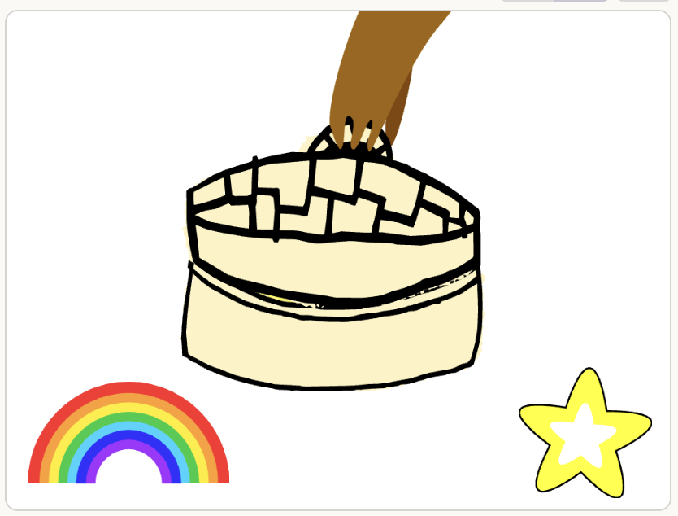

## Position the star

Move the star, then make it send a message when it is clicked.

## Step 1

Click on the **star sprite**.

{:width="80px"}

## Step 2

On the stage, drag the star to the right of the stage.

## Step 3

Position the star using the `go to x: y:`{:class="block3motion"} block.

```blocks3
+when green flag clicked
+go to x: (153) y: (-123)
```

## Step 4

Send a new message called `stars`{:class="block3events"} when the star is clicked.

```blocks3
+when this sprite clicked
+broadcast (stars v)
```

## Now run your code

Check that the **Star** is where you want it on the stage.

{:width="450px"}
