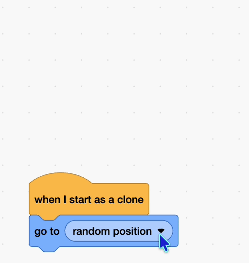

## Make a star clone

Make a clone of the star above the dumpling.

{:width="80px"}

Click on the **star sprite**.

## Step 1

Make a clone of the star when it is clicked.

```blocks3
when this sprite clicked
broadcast (stars v)
+create clone of (myself v)
```

## Step 2

When the clone starts, move it to the dumpling, then glide.

```blocks3
+when I start as a clone
+go to (dumpling v)
+glide (1) secs to (random position v)
```

> [!TIP]
>
> Use the `go to random position`{:class="block3motion"} block and select 'dumpling' from the drop-down menu.
>
> {:width="450px"}

## Now run your code

Click on the **star**. Check that a star clone glides away from the dumpling.

{:width="450px"}
