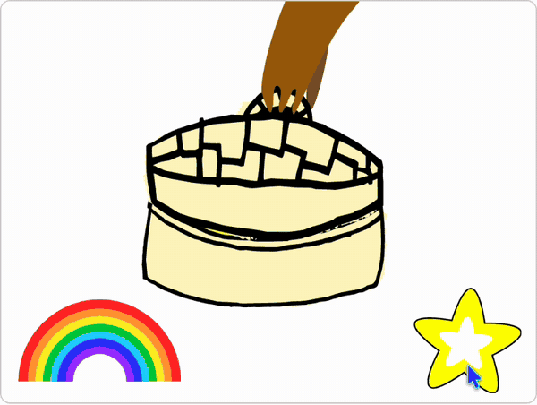

## Make star clones

Make copies of the star to shower over the dumpling.

{:width="80px"}

## Step 1

Click on the **star sprite**.

## Step 2

Make 15 copies of the star, one after another.

```blocks3
when this sprite clicked
broadcast (stars v)
+repeat (15)
create clone of (myself v)
wait (0.1) seconds
+end
```

## Now run your code

Click on the **star**. Check that a pile of copies builds up on top of the button.

{:width="450px"}
