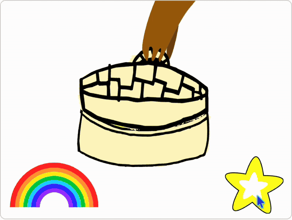

## Style the stars


Give each star clone colour effects and change size.

{:width="80px"}

You're still working on the **star sprite**.

## Step 1

Change the colour of each clone.

```blocks3
when I start as a clone
+change [color v] effect by (25)
go to (dumpling v)
glide (1) secs to (random position v)
```

> [!TIP]
>
> You can try other effects by clicking the 'color' drop-down menu.

## Step 2

Set the size of each clone.

```blocks3
when I start as a clone
change [color v] effect by (25)
+set size to (50) %
go to (dumpling v)
glide (1) secs to (random position v)
```

## Now run your code

Click on the **star**. Check that the star clones are green and smaller.

{:width="450px"}
