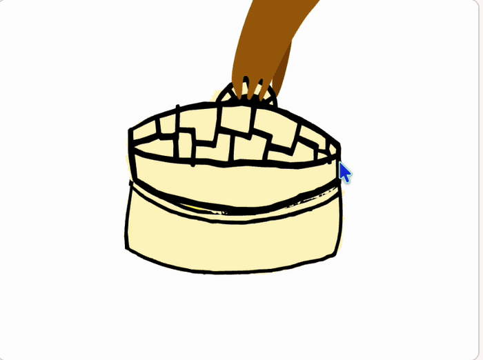

## Animate the dumpling

Make the dumpling look like it is being squished by swapping between its costumes.

## Step 1

Click on the **dumpling sprite**.

{:width="80px"}

## Step 2


Slow the swap down.

```blocks3
when I receive [lid v]
repeat (15)
next costume
wait (0.1) seconds
end
```

> [!TIP]
>
> Play with the number of repeats to make the animation longer or shorter.

## Step 3

Go back to the smiling costume at the end.

```blocks3
when I receive [lid v]
repeat (15)
next costume
wait (0.1) seconds
end
+switch costume to (costume 1 v)
```

## Now run your code

Click on the **lid**. Check that the dumpling squashes and stretches.

{:width="450px"}
