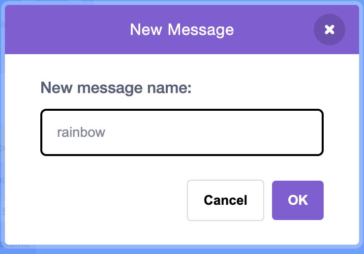

## Tell the dumpling

Send a message so the dumpling knows the lid has been lifted.

{:width="80px"}

You're still working on the **lid sprite**.

Send a new message called `dumpling clicked`{:class="block3events"} as the lid lifts.

```blocks3
when this sprite clicked
+broadcast (dumpling clicked v)
glide (1) secs to x: (65) y: (120)
wait (1) seconds
glide (1) secs to x: (0) y: (0)
```

> [!TIP]
>
> Click the drop-down on the `broadcast`{:class="block3events"} block and choose 'New message' to name it.
>
> {:width="250px"}

The dumpling answers the message in the next step.
