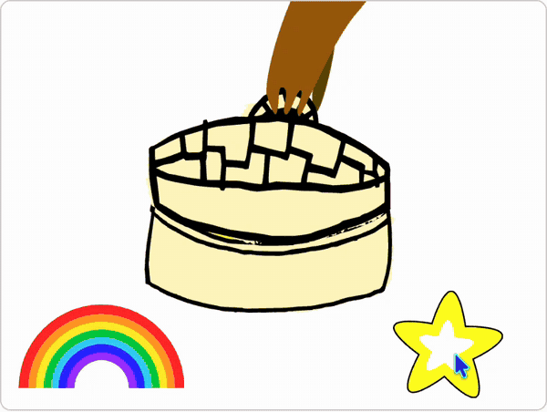

## Spin the dumpling

Make the dumpling spin around with the stars.

## Step 1

Click on the **dumpling sprite**.

{:width="80px"}

## Step 2

Turn the dumpling 85 times when it receives the `stars`{:class="block3events"} message.

```blocks3
+when I receive [stars v]
+repeat (85)
turn cw (15) degrees
+end
```

> [!TIP]
>
> Experiment with how many times and how far the dumpling turns to get the spin effect you want.

## Step 3

Point the dumpling the right way up when the spin ends.

```blocks3
when I receive [stars v]
repeat (85)
turn cw (15) degrees
end
+point in direction (90)
```

## Now run your code

Click on the **star**. Check that the dumpling spins round and is upright at the end.

{:width="450px"}
