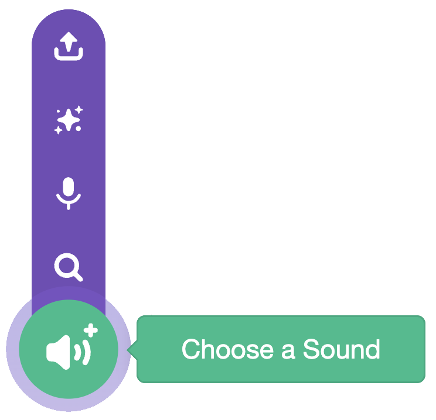
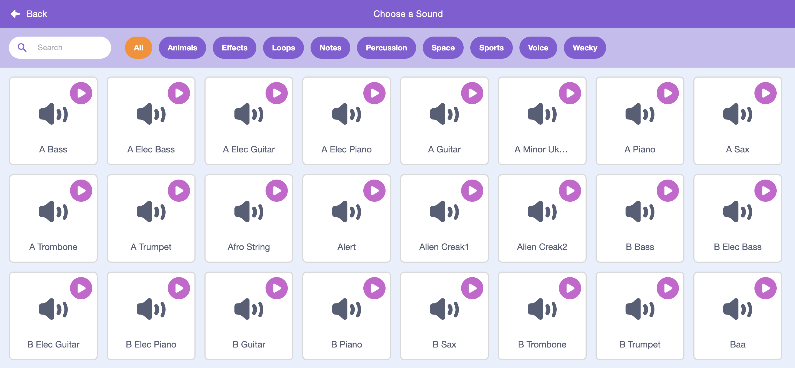

## Find a spinning sound

Play a sound for as long as the spin lasts.

{:width="80px"}

You're still working on the **dumpling sprite**.

## Step 1

Click on the **Sounds** tab.

{:width="450px"}

## Step 2

Click **Choose a Sound**.

{:width="250px"}

## Step 3

Choose a spinning sound from the library.

{:width="450px"}

**Test:** Click **Play**. Check that you can hear your spinning sound.
