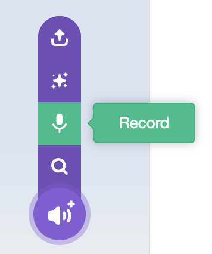
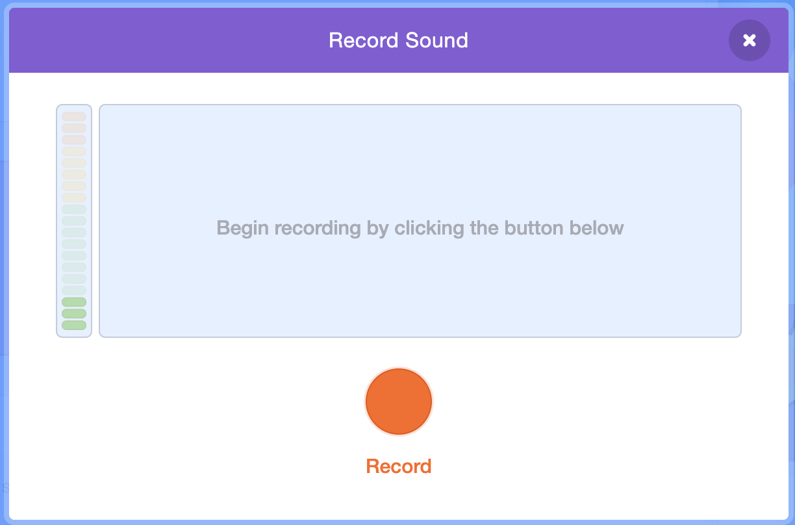
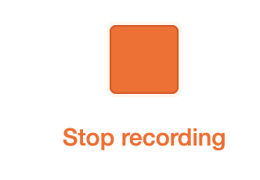
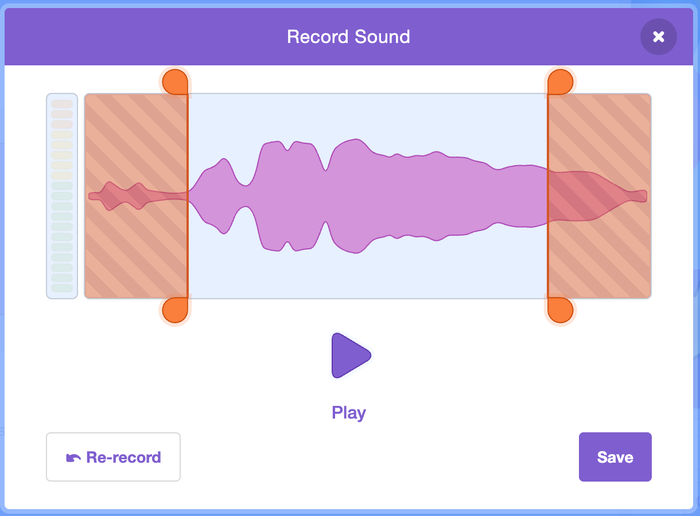

## Record a squishy sound

Record your own sound for the animation.

{:width="80px"}

You're still working on the **dumpling sprite**.

## Step 1

Open the **Sounds** tab.

{:width="450px"}

## Step 2

Hover over **Add a Sound** and click **Record**.

{:width="250px"}

## Step 3

Click the **Record** button and make a squishy noise.

{:width="450px"}

## Step 4

Click **Stop recording** when you are done.

{:width="250px"}

## Step 5

Click **Save** to keep your recording.

{:width="450px"}

## Now run your code

Click **Play**. Check that you can hear your sound.
