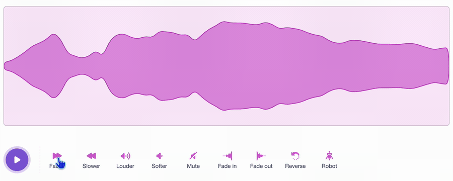
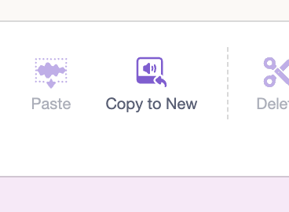
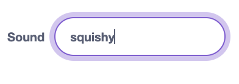

## Edit your sound

Speed your sound up to make it higher pitched.

{:width="80px"}

You're still working on the **dumpling sprite**.

## Step 1

Click **Faster** to make your sound higher pitched.

{:width="450px"}

> [!TIP]
>
> Click **Copy to New** to keep this version of your sound and carry on editing a copy.
>
> {:width="250px"}

## Step 2

Rename your sound.

{:width="250px"}

**Test:** Click **Play**. Check that your sound has changed.
