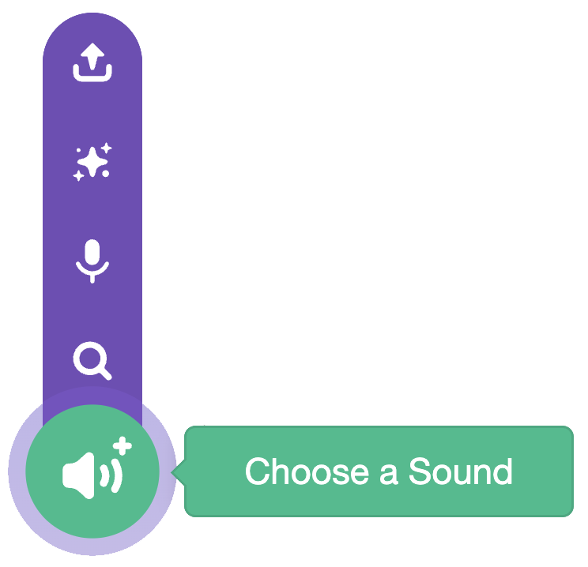
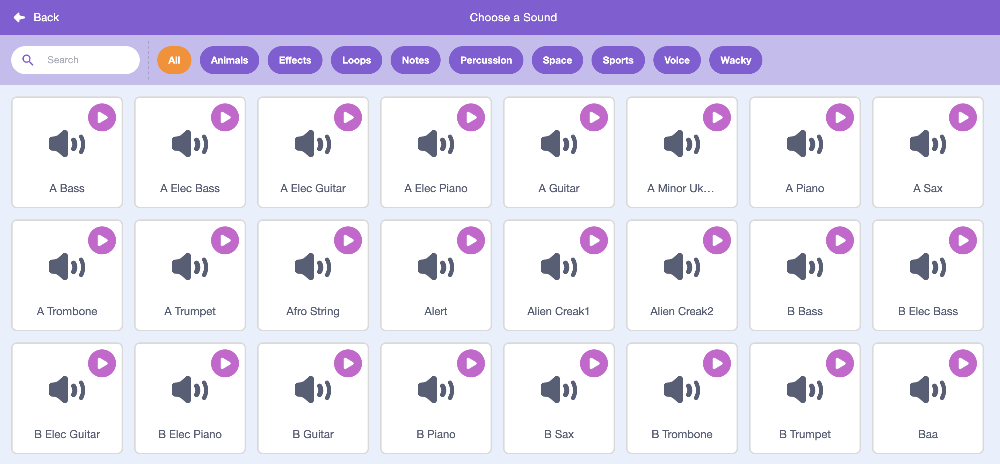

## Add a squishy sound

Play a sound while the dumpling is squashed.

{:width="80px"}

## Step 1

Open the **Sounds** tab.

{:width="450px"}

## Step 2

Click **Choose a Sound**.

{:width="250px"}

## Step 3

Pick a squishy sound from the library.

{:width="450px"}

## Step 4

Back in the **Code** tab, play your sound as the squash starts.

```blocks3
when I receive [dumpling clicked v]
+start sound (squishy v)
repeat (15)
next costume
wait (0.1) seconds
end
switch costume to (costume 1 v)
```

## Now run your code

Click on the **lid**. Check that your sound plays while the dumpling squashes.

{:width="450px"}
