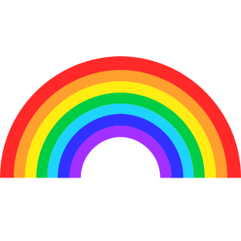

## Add a rainbow button

Add a button the player can click for a rainbow effect.

{:width="80px"}

## Step 1

Choose the **Rainbow sprite** from the sprite library.

Drag it to the bottom right of the stage.

## Step 2

Add a `when this sprite clicked`{:class="block3events"} block and a `broadcast`{:class="block3events"} block set to a new message called `rainbow`{:class="block3events"}.

```blocks3
+when this sprite clicked
+broadcast (rainbow v)
```

The dumpling answers the message in the next step.
