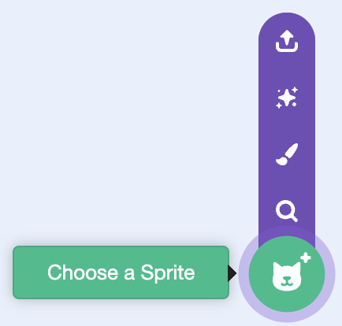
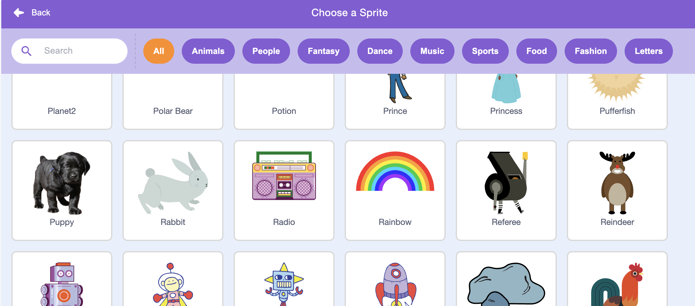
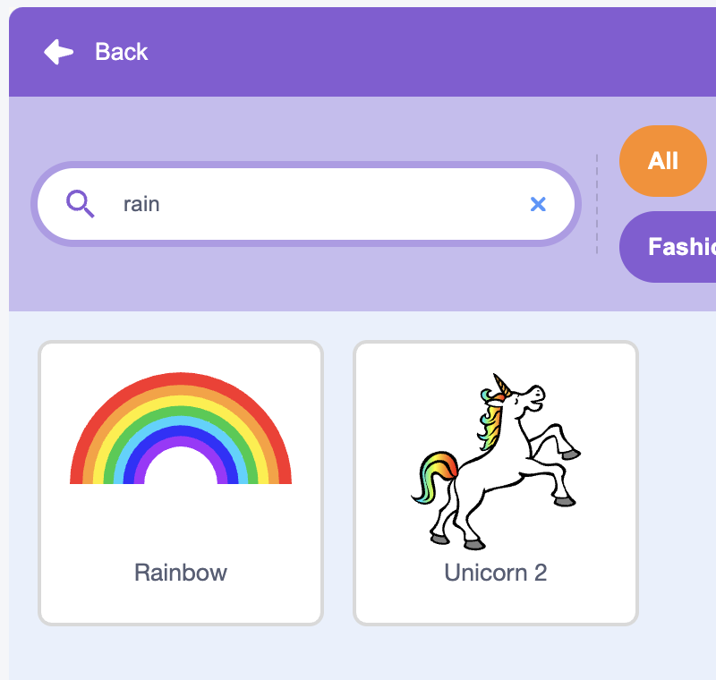

## Add a rainbow button

Make a new sprite to use as a button.

## Step 1

Click **Choose a Sprite**.

{:width="250px"}

## Step 2

Choose the **rainbow sprite** from the sprite library.

{:width="450px"}

> [!TIP]
>
> Type 'rainbow' into the search bar to find it quickly.
>
> {:width="450px"}

**Test:** Check that your new rainbow sprite appears on the stage.

