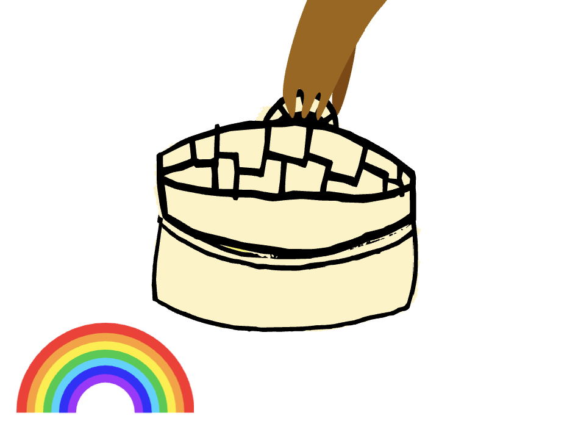

## Make it clickable

Move the sprite and set up the click.

{:width="80px"}

You're still working on the **rainbow sprite**.

## Step 1

On the stage, position the rainbow where you want it.

## Step 2

Click on the **Code** tab.

{:width="450px"}

## Step 3

Add the `go to x: y:`{:class="block3motion"} block, so the button starts in the same place every time. Don't change the numbers in the block.

```blocks3
+when green flag clicked
+go to x: () y: ()
```

## Step 4

Stop the rainbow from being dragged on the stage.

```blocks3
when green flag clicked
go to x: () y: ()
+set drag mode [not draggable v]
```

## Step 5

Send the message `rainbow`{:class="block3events"} when the sprite is clicked.

```blocks3
+when this sprite clicked
+broadcast (rainbow v)
```

## Step 6

Make the rainbow get smaller, then go back to its normal size, when it is clicked.

```blocks3
when this sprite clicked
broadcast (rainbow v)
+change size by (-10)
+wait (0.1) seconds
+change size by (10)
```

## Now run your code

Drag the **rainbow** to a new place on the stage. Click the **Green Flag**. Check that the **rainbow** goes back to where you positioned it.

Click on the **rainbow**. Check that it gets smaller, then goes back to its normal size.

{:width="450px"}
