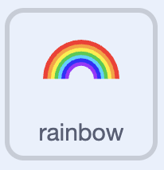
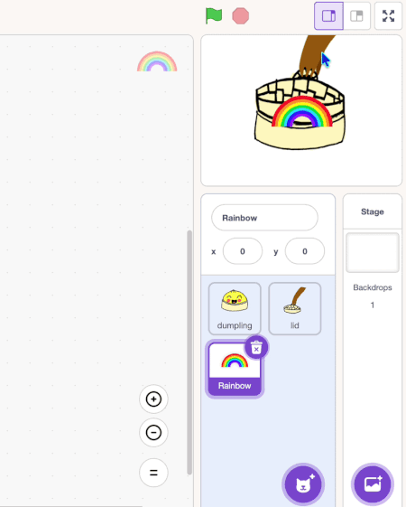
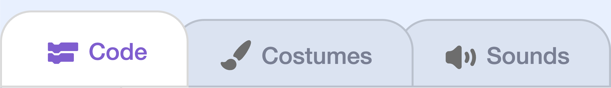

## Make it clickable

Move the sprite and set up the click.

{:width="80px"}

Still working in the **rainbow sprite**.

## Step 1

In the stage, position the rainbow where you want it.

> [!TIP]
>
> You can change the stage to the large view.
>
> {:width="450px"}

## Step 2

Click on the **Code** tab.

{:width="450px"}

## Step 3

Add the `x: y:` position in blocks, so the button starts in the same place every time.

```blocks3
+when green flag clicked
+go to x: (145) y: (-114)
```

> [!TIP]
>
> Scratch fills in the `x:` and `y:` values from where your sprite is, so your numbers will be different.

## Step 4

Send a new message called `rainbow`{:class="block3events"} when the rainbow is clicked.

```blocks3
+when this sprite clicked
+broadcast (rainbow v)
```

The dumpling answers the message in the next step.
