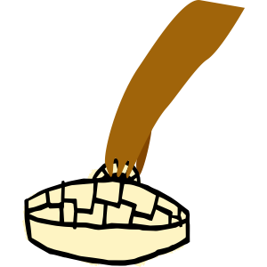
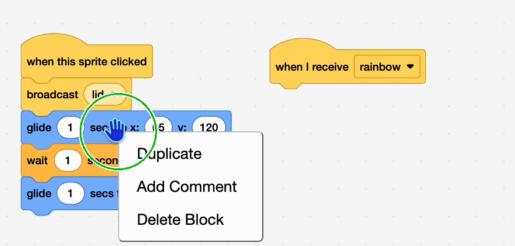

## Lift the lid for the rainbow

Make the lid move when the rainbow is clicked.

## Step 1

Click on the **lid sprite**.

{:width="80px"}

## Step 2

Add the glide blocks when the rainbow message is received.

```blocks3
+ when I receive [rainbow v]
glide (1) secs to x: (65) y: (120)
wait (1) seconds
glide (1) secs to x: (0) y: (0)
+end
```

> [!TIP]
>
>Right click to duplicate the glide blocks and move them under the `when I receive rainbow`{:class="block3events"}.
>
>{:width="450px"}

## Now run your code

Click on the **rainbow** and check that the lid lifts up.

{:width="450px"}
