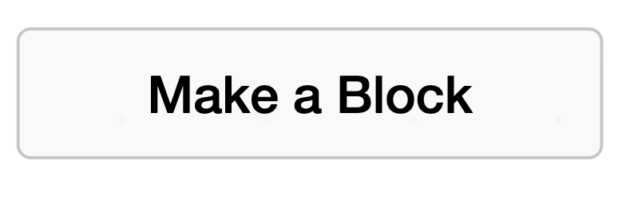
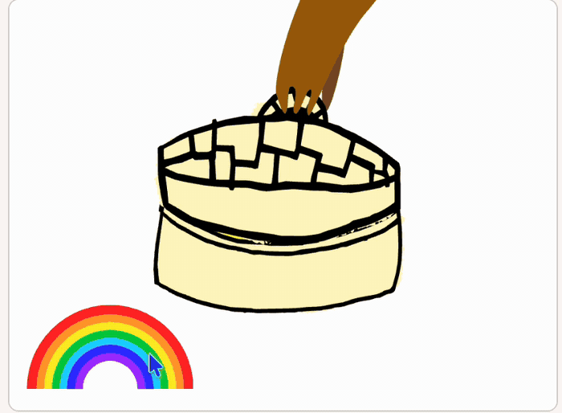

## Lift the lid for the rainbow

Make the lid move when the rainbow is clicked.

## Step 1

Click on the **lid sprite**.

{:width="80px"}

## Step 2

The lid needs the same glide blocks again. A **My Block** lets you use the same blocks in more than one script.

Click on **My Blocks**, then click **Make a Block**. Name the block `open` and click **OK**.

{:width="250px"}

## Step 3

Move the glide blocks from the `when this sprite clicked`{:class="block3events"} script to the `define open`{:class="block3myblocks"} block.

```blocks3
+define open
glide (1) secs to x: (65) y: (120)
wait (1) seconds
glide (1) secs to x: (0) y: (0)
```

## Step 4

Add the `open`{:class="block3myblocks"} block under the `broadcast`{:class="block3events"} block.

```blocks3
when this sprite clicked
broadcast (lid v)
+open
```

## Step 5

Use the `open`{:class="block3myblocks"} block when the rainbow message is received.

```blocks3
+when I receive [rainbow v]
+open
```

## Now run your code

Click on the **rainbow**. Check that the lid glides up, then glides back down.

{:width="450px"}
