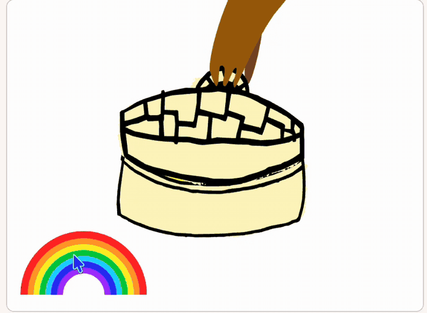

## Make a rainbow dumpling

Change the colours of the dumpling.


## Step 1

Click on the **dumpling sprite**.

{:width="80px"}

## Step 2

Look for when **rainbow** message arrives.

```blocks3
when I receive [rainbow v]
```

## Step 3

Make the colour effect change, and repeat it.

```blocks3
when I receive [rainbow v]
+repeat (15)
change [color v] effect by (25)
wait (0.1) seconds
+end
```

## Step 4

Clear the effect after the loop.

```blocks3
when I receive [rainbow v]
repeat (15)
change [color v] effect by (25)
wait (0.1) seconds
end
+clear graphic effects
```

## Now run your code

Click on the **rainbow**. Check that the dumpling flashes through different colours.

{:width="450px"}
